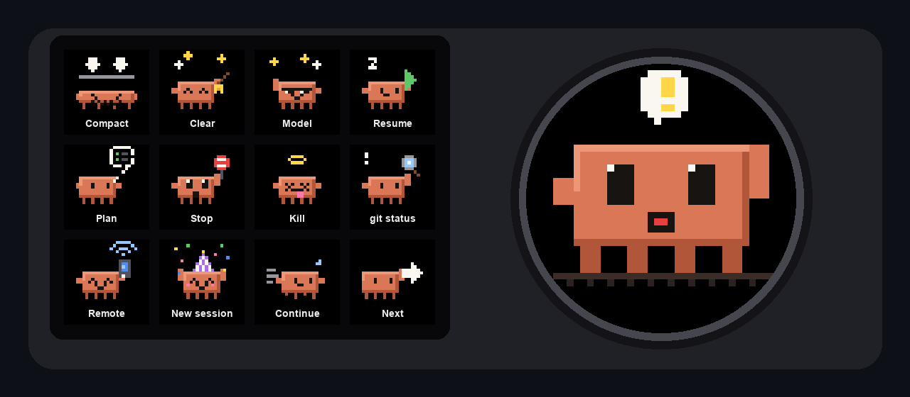
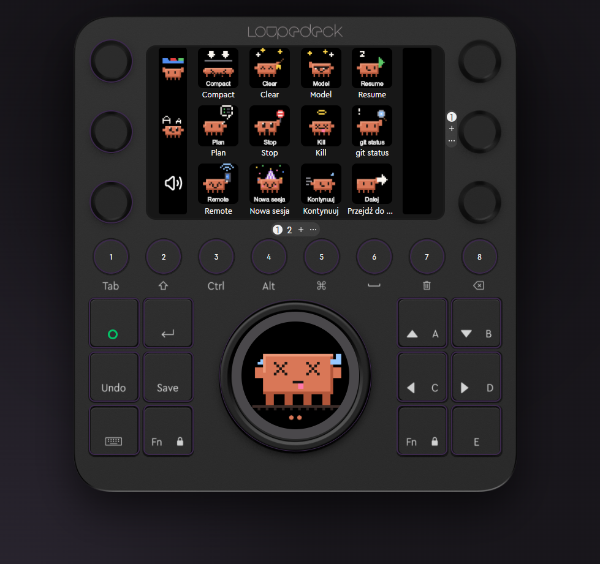
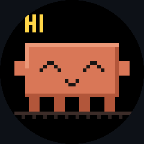
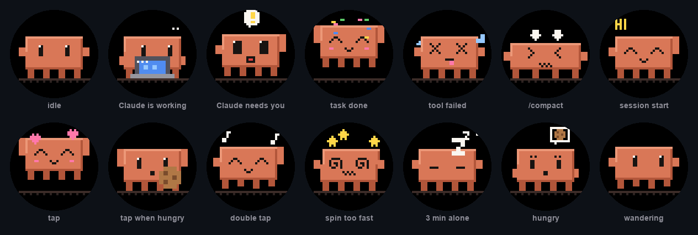

<p align="center">
  
</p>

<h1 align="center">Loupedeck CT × Claude Code</h1>

<p align="center">
  <b>Turn a Loupedeck CT into a control deck for Claude Code</b>, with hand-coded pixel-art tiles<br>
  and a pixel-art tamagotchi on the big wheel that reacts to what Claude is doing.
</p>

<p align="center">
  <b>English</b> · <a href="README.de.md">Deutsch</a> · <a href="README.pl.md">Polski</a>
</p>

---

## What you get

| | |
|---|---|
| **12 + 12 touch tiles** | `/compact`, `/clear`, `/model`, `/resume`, `/remote-control`, plan mode, Esc, Ctrl+C, `git status`, new session, `claude -c`, and a second page of your own prompts. |
| **8 round buttons** | Jump straight to terminal tab 1–8 (one Claude Code session per tab). |
| **Dials** | Previous/next tab, terminal font size, system volume. |
| **Big wheel** | Clawd, a tamagotchi that lives on the round screen. Turning the wheel still scrolls your terminal. |
| **Claude Code hooks** | Clawd types on a laptop while Claude works. When Claude needs you, he waves, shows a `!` and **the wheel vibrates**. He celebrates when a task is done and sweats when a tool fails. |
| **3 languages** | Tile captions in English, German or Polish. Claude Code commands keep their real names. |
| **Everything is code** | The profile, every icon and every animation frame are generated by scripts. You can rebuild, tweak and version all of it. |

<table>
  <tr>
    <td align="center" width="62%"><br>
      <sub><b>The real thing</b> (Polish captions). A tool just failed in one session, so Clawd shows X eyes and sweat drops.<br>The two dots under him are two Claude Code sessions still working.</sub></td>
    <td align="center"><br>
      <sub>All wheel animations, generated pixel by pixel in <code>art/pixelart.py</code>.</sub></td>
  </tr>
</table>

## Clawd, the wheel tamagotchi

<p align="center"></p>

| You do | Clawd does |
|---|---|
| tap the wheel | gets petted (hearts). If he is hungry, he eats a cookie instead. |
| double tap | dances |
| long press | sends **Enter** (the wheel's old job) |
| turn the wheel | scrolls the terminal; spin too fast and he gets dizzy |
| leave him alone for 3 min | falls asleep |
| forget him for ~45 min | gets hungry (thought bubble with a cookie) |

| Claude Code does (via hooks) | Clawd does |
|---|---|
| you send a prompt / a tool runs | types on his laptop |
| a permission prompt, question or idle prompt | waves, shows `!`, **the wheel vibrates** |
| a tool fails | X eyes, sweat drops, shakes |
| `/compact` | gets squished |
| the turn ends (`Stop`) | jumps, confetti |
| a session starts | says HI |

Dots at the bottom of the wheel show how many sessions are working (orange) or waiting for you (blinking yellow), up to 8.

## Requirements

- **Loupedeck CT** and **Logi Plugin Service 6.x** (the current Loupedeck software). Tested with 6.4.1 on Windows 11.
- **Claude Code** in Windows Terminal (native or WSL). On macOS it is meant for iTerm2 / Ghostty, but the Mac path is not tested yet (see [macOS](#macos)).
- **Python 3.9+** with Pillow (`pip install pillow`) for the generators.
- **.NET 10 SDK** to build the wheel plugin. Logi Plugin Service 6.4 runs on .NET 10, so .NET 8 is not enough.

## Install

The repo is a [Claude Code skill](https://docs.claude.com/en/docs/claude-code/skills). The easiest path is to let Claude do it:

```bash
git clone https://github.com/kazziu/loupedeck-claude-code ~/.claude/skills/loupedeck-claude-code
```

then in Claude Code:

```
/loupedeck-claude-code
```

The skill checks your OS, terminal and Loupedeck install and asks which language you want. It then builds the plugin, generates the profile, installs everything (with backups) and walks you through a 2-minute test on the device.

<details>
<summary><b>Manual install (Windows)</b></summary>

```powershell
$SK = "$HOME\.claude\skills\loupedeck-claude-code"; $C = "$HOME\.config\loupedeck-cc"
mkdir $C -Force; Copy-Item "$SK\docs\prompts.en.txt" "$C\prompts.txt"     # or prompts.de / prompts.pl

python "$SK\build_plugin.py" --out "$C\build-plugin"                       # needs dotnet 10
python "$SK\gen_profile.py" --os win --out "$C\build-win" --prompts "$C\prompts.txt" --lang en --wheel-plugin
python "$SK\gen_profile.py" --os win --out "$C\build-win" --prompts "$C\prompts.txt" --lang en --wheel-plugin --target default
powershell -File "$SK\install_win.ps1" -Build "$C\build-win" -Plugin "$C\build-plugin\ClaudeMascot" -MakeDefault

python "$SK\hooks\install_hooks.py"                                        # optional: Claude Code hooks
```

Windows Terminal already maps `Ctrl+Alt+1…8` to tabs. For the "tabs" dial, add `nextTab` / `prevTab` on `ctrl+alt+right` / `ctrl+alt+left` with `"tabSwitcherMode": "disabled"`.
</details>

<details>
<summary><b>What gets changed on your machine</b></summary>

| Where | What | Undo |
|---|---|---|
| `%LOCALAPPDATA%\Logi\LogiPluginService\Applications\Loupedeck20\windowsterminal` | profile that follows Windows Terminal | delete the folder |
| `…\Loupedeck20\@_defaultwin\Profiles\<GUID>` + `ApplicationInfo.json` | same profile as the CT default (with `-MakeDefault`); your old default profile is kept | pick your old profile in the Loupedeck app |
| `…\LogiPluginService\Plugins\ClaudeMascot` | the wheel plugin | delete the folder |
| `~/.claude/settings.json` → `hooks` | 15 async hooks that write `~/.config/loupedeck-cc/sessions/*.json` | `python hooks/install_hooks.py --remove` |
| `~/.config/loupedeck-cc/backup-*` | backups taken before every install | |
</details>

## Customize

- **Your prompts (page 2):** edit `~/.config/loupedeck-cc/prompts.txt`. Each line is `Label | prompt text | icon`. Then run the skill again.
- **Language:** `--lang en|de|pl`, or `{"lang": "de"}` in `~/.config/loupedeck-cc/config.json`. Translations live in `LABELS` in `gen_profile.py`, so adding a language means adding one dictionary.
- **Button map:** `gen_profile.py` is the source of truth. Every tile is one line like `b.text_enter("Compact", "/compact", "compact")`.
- **Icons and animations:** `art/pixelart.py`. Each icon is a small function on a 20×20 grid, and each wheel state is a function on a 40×40 grid. Run `python art/render_docs.py` to preview everything as PNG/GIF.

## How it works

```
gen_profile.py ──► ProfileInfo.json + ActionIcons/*.ict ──► Logi Plugin Service ──► tiles, buttons, dials
art/pixelart.py ─┬► tile icons (base64 PNG inside .ict)
                 └► wheel frames ──► plugin/ (C#, .NET 10) ──► WheelToolClawd draws 240×240 on the wheel
Claude Code hooks ──► hooks/mascot_hook.py ──► ~/.config/loupedeck-cc/sessions/*.json ──► plugin reads every ~1 s
```

The Loupedeck profile format is not documented. Everything here was worked out by reading the
profiles that ship with the software, the configuration UI bundle and the service's IL code.
The notes are in **[docs/loupedeck-format.md](docs/loupedeck-format.md)**. If you are building
anything for Loupedeck / Logi Plugin Service, start there; it will save you a day.

Highlights:

- Profiles are plain JSON (`ProfileInfo.json`). `Loupedeck20` = CT, `30` = Live, `50` = Live S.
- Macro steps use `$@Generic___@KeyboardKey` with `"<Mods+Key>___<keyboardLayoutId>___<label>___"` and `$@Generic___@SendText`. The key names (`Back`, `Return`, `Minus`, `Equals`, `Key0`…) come from a table in the config UI.
- Tile icons are `.ict` JSON files (base64 PNG + caption, coordinates in percent) named after the action id.
- **Full-screen wheel:** subclass `WheelTool` in a plugin and reference it as `templateName: "<PluginName>___<ClassName>"`. Without the prefix the service only looks in the profile's *native* plugin, and the wheel stays dead.
- The service loads plugin DLLs from memory, so `Assembly.Location` is empty. Embed your assets.
- Even "universal" plugins need a `ClientApplication` subclass or the loader refuses them.

## macOS

The generator has a `mac` branch (`⌘1…8` for iTerm2 / Ghostty tabs, `@_defaultmac`), but it has not been
tested on a Mac yet. Still to do: an `install_mac.sh` modelled on `install_win.ps1`, a CGEvent-based scroll
in the plugin (it uses `user32` today), and checking the profile and SDK paths. The skill tells Claude
exactly what to check. PRs welcome.

## Troubleshooting

| Symptom | Fix |
|---|---|
| Wheel is black / dead | The wheel `templateName` must be `ClaudeMascot___WheelToolClawd`. Check `%LOCALAPPDATA%\Logi\LogiPluginService\Logs\plugin_logs\ClaudeMascot.log`. |
| `Cannot load plugin … already loaded` in the log | Normal: the service scans plugins twice. |
| Plugin listed as disabled | Restart the service. The disabled list lives in memory only. |
| Typed text loses characters | Increase the `("sleep", 80)` step in `text_enter` in `gen_profile.py`. |
| Mascot never reacts to Claude | Run `python hooks/install_hooks.py`, start a new Claude Code session and check that `~/.config/loupedeck-cc/sessions/` gets files. |

## Credits & disclaimer

Unofficial fan project, not affiliated with or endorsed by Anthropic or Logitech.
*Claude* and *Claude Code* are trademarks of Anthropic. *Loupedeck* and *Logi* are trademarks of Logitech.
The mascot is fan art drawn from scratch in Python, one pixel at a time.

Built in one long, fun session by [@kazziu](https://github.com/kazziu) together with Claude Code.

[MIT License](LICENSE)
